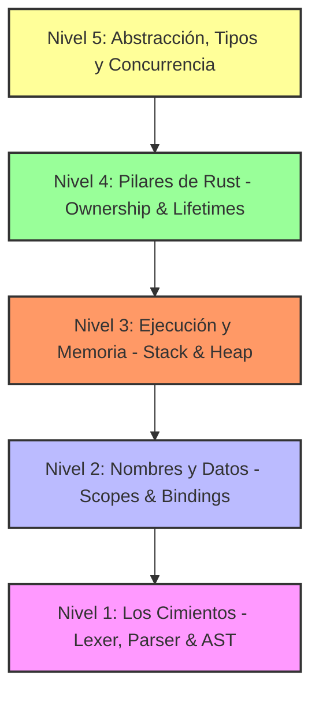

# 🗂️ Arquitectura y Taxonomía de un Lenguaje de Programación (Aplicado a Rust)

Este documento es una guía estructural y teórica diseñada para fragmentar y comprender cómo funciona un lenguaje de programación, utilizando a **Rust** como el modelo de estudio. El conocimiento se divide en **5 niveles jerárquicos**, desde las partículas elementales del código hasta los conceptos avanzados de concurrencia y metaprogramación.

Para cada concepto, aplicamos la triple lente de aprendizaje del libro:
*   **Calle 🛣️ (La Analogía):** Un símil cotidiano para anclar la idea intuitivamente.
*   **Taller 🛠️ (El Código y el Compilador):** Ejemplos prácticos y el comportamiento del compilador.
*   **Sótano 🕳️ (La Memoria y el Silicio):** Qué ocurre físicamente en la memoria RAM y en la CPU.

---



---

## 🧱 Nivel 1: Los Cimientos (Anatomía del Código)
*Cómo se lee, se escribe y se procesa un programa a nivel de compilación.*

### 1. Léxico y Tokens
El reconocimiento de las unidades mínimas de información por parte del analizador léxico (*lexer*).
*   **Calle 🛣️:** Las letras y palabras individuales del diccionario. "let", "mut", "fn" u operadores como "+" no tienen sentido por sí solos, son solo piezas lingüísticas.
*   **Taller 🛠️:** El lexer toma el archivo de texto y lo trocea en un flujo de tokens:
    ```rust
    let mut x = 10;
    // Tokens generados: [Keyword(Let), Keyword(Mut), Ident("x"), Operator(Eq), Literal(10), Semicolon]
    ```
*   **Sótano 🕳️:** La CPU no entiende de texto. El lexer descarta espacios en blanco y comentarios para generar una representación en memoria compacta de enteros binarios (IDs de tokens) que consume una fracción diminuta de RAM.

### 2. Sintaxis
La gramática formal y las reglas estructurales que determinan cómo deben ordenarse los tokens.
*   **Calle 🛣️:** La estructura de una oración. "Perro el corre rápido" viola la sintaxis, mientras que "El perro corre rápido" es sintácticamente correcto.
*   **Taller 🛠️:** El *parser* toma los tokens y construye el **AST (Abstract Syntax Tree)**. Si falta un punto y coma o un paréntesis, el compilador arroja un error de sintaxis y detiene el proceso de parsing.
*   **Sótano 🕳️:** El AST se almacena en memoria como una estructura de datos en árbol (nodos de operaciones y operandos), preparando el código para el análisis semántico y la posterior traducción a código intermedio (MIR).

### 3. Semántica
El significado lógico real y las reglas de validez de lo que hace el código.
*   **Calle 🛣️:** "La mesa corre rápido". La oración es gramaticalmente correcta (sintaxis perfecta), pero físicamente imposible (no tiene sentido semántico).
*   **Taller 🛠️:** Rust valida la semántica en compilación mediante el sistema de tipos y lifetimes. Si intentas sumar un `String` con un `i32`, la sintaxis es correcta, pero el compilador arroja un error semántico porque esa operación carece de sentido lógico.
*   **Sótano 🕳️:** La semántica define el comportamiento dinámico del código en ejecución: qué instrucciones de máquina concretas se emitirán para lograr el propósito del desarrollador sin producir comportamiento indefinido (*Undefined Behavior*).

### 4. Expresiones (Expressions)
Fragmentos de código que se evalúan y devuelven un valor.
*   **Calle 🛣️:** Una pregunta a la que siempre respondes con un dato. "¿Cuánto es 5 + 5?" -> "10".
*   **Taller 🛠️:** En Rust, casi todo es una expresión (bloques `{}`, condicionales `if`, `match`):
    ```rust
    let valor = if verdadero { 42 } else { 0 }; // El bloque 'if' devuelve un valor
    ```
*   **Sótano 🕳️:** Las expresiones permiten que el compilador optimice la asignación en registros de la CPU, evitando la copia intermedia de variables temporales.

### 5. Sentencias o Declaraciones (Statements)
Instrucciones que realizan una acción o comando pero no devuelven un valor.
*   **Calle 🛣️:** Una orden directa: "Limpia la mesa". La orden se ejecuta, pero no genera un objeto físico o respuesta de vuelta.
*   **Taller 🛠️:** En Rust, añadir un punto y coma `;` a una expresión la convierte en una sentencia (devolviendo el tipo unitario `()`).
    ```rust
    let x = 5; // Una sentencia de declaración. No retorna un valor que puedas asignar.
    ```
*   **Sótano 🕳️:** En ensamblador, las sentencias suelen traducirse a instrucciones de control de flujo o de almacenamiento directo de datos en memoria sin pasar valores al acumulador de la CPU.

### 6. Declaración (Declaration)
Introducción de un nuevo identificador (nombre) y su tipo asociado al compilador.
*   **Calle 🛣️:** Reservar un casillero en una oficina de correos y ponerle una etiqueta con tu nombre. El casillero está vacío, pero ya te pertenece su espacio.
*   **Taller 🛠️:**
    ```rust
    let numero: i32; // Declaración pura de la variable 'numero' con tipo de 32 bits
    ```
*   **Sótano 🕳️:** El compilador anota en su tabla de símbolos la existencia del identificador y calcula cuántos bytes debe reservar en el Stack Frame (en este caso, 4 bytes para el `i32`) una vez se entre a la función.

### 7. Asignación (Assignment)
El acto de introducir o cambiar el valor almacenado en un identificador previamente declarado.
*   **Calle 🛣️:** Abrir el casillero de correos que ya tiene tu nombre y meter un paquete físico dentro.
*   **Taller 🛠️:**
    ```rust
    let mut x = 5; // Declaración y asignación inicial
    x = 10;        // Asignación (o reasignación) utilizando el operador =
    ```
*   **Sótano 🕳️:** La CPU genera una instrucción `MOV` (o equivalente en la arquitectura) para transferir el valor crudo en bytes (`10` en binario) directamente a la dirección de memoria física asignada al identificador `x`.

---

## 🏷️ Nivel 2: Gestión de Nombres y Datos
*Organización, alcance y control de visibilidad de la información.*

### 8. Scope / Ámbito (Alcance)
Las reglas que determinan la visibilidad y el tiempo de vida de un identificador, limitadas por llaves `{}`.
*   **Calle 🛣️:** Lo que pasa en Las Vegas, se queda en Las Vegas. Si compras algo allí, no puedes usarlo al volver a tu casa si lo dejaste allá.
*   **Taller 🛠️:**
    ```rust
    {
        let x = 5;
    } // x muere aquí
    // println!("{}", x); // ERROR: x no está en este scope
    ```
*   **Sótano 🕳️:** Los scopes controlan el crecimiento y decrecimiento del Stack Frame de la CPU. Al cerrarse una llave, Rust destruye las variables del scope, liberando espacio del Stack e inyectando la función `drop()` si contienen recursos del Heap.

### 9. Shadowing (Ocultamiento)
Declarar una nueva variable con el mismo nombre que otra ya existente, ocultando la anterior temporalmente.
*   **Calle 🛣️:** Poner un post-it nuevo escrito encima de un post-it viejo con el mismo nombre de variable. El viejo sigue debajo, pero solo puedes leer el de arriba.
*   **Taller 🛠️:**
    ```rust
    let texto = "42";
    let texto: i32 = texto.parse().unwrap(); // Shadowing: cambia el tipo de String a entero
    ```
*   **Sótano 🕳️:** Físicamente, el compilador crea una variable completamente nueva en una dirección de memoria diferente del Stack. No hay sobrescritura de memoria del dato viejo en tiempo de ejecución; simplemente el compilador remapea el nombre a la nueva dirección.

### 10. Binding (Ligadura)
El enlace asociativo entre un nombre (identificador) y un valor, tipo o dirección de memoria.
*   **Calle 🛣️:** Colocar una etiqueta adhesiva con el nombre "MiGato" en el collar de un felino específico. El nombre queda ligado al animal.
*   **Taller 🛠️:** En Rust no se habla simplemente de "variables", sino de "variable bindings", porque vinculamos patrones a valores:
    ```rust
    let (a, b) = (1, 2); // Ligadura de múltiples nombres mediante un patrón de tupla
    ```
*   **Sótano 🕳️:** En la tabla de símbolos del compilador, se asocia el nombre lógico con un desplazamiento (offset) relativo al Stack Pointer (`SP`) y se le adjudican sus metadatos de tipo.

### 11. Inferencia de Tipos
La capacidad de deducir automáticamente el tipo de dato en compilación analizando cómo se usa en el código.
*   **Calle 🛣️:** Si ves a alguien entrar a una veterinaria cargando una caja que hace "miau", deduces que hay un gato dentro sin necesidad de que abran la caja para mostrártelo.
*   **Taller 🛠️:** Rust utiliza un algoritmo derivado de Hindley-Milner. No requiere tipado explícito en variables locales si el flujo posterior aclara el tipo:
    ```rust
    let mut numeros = Vec::new(); // ¿Vec de qué?
    numeros.push(42);            // El compilador infiere que es un Vec<i32>
    ```
*   **Sótano 🕳️:** A nivel binario no existe la inferencia de tipos; los tipos están completamente resueltos. La CPU solo opera con bytes crudos y sabe si está ejecutando instrucciones para enteros o flotantes porque el compilador ya eligió los opcodes exactos.

---

## 💾 Nivel 3: El Núcleo de la Ejecución y la Memoria
*Interacción directa con los recursos físicos del sistema.*

### 12. Stack y Heap (Pila y Montón)
Las dos áreas principales de la memoria RAM destinadas a almacenar datos durante la ejecución.
*   **Calle 🛣️:**
    *   **Stack:** Una pila de platos en un buffet. Apilar y desapilar es instantáneo, pero todos los platos deben tener el mismo tamaño físico.
    *   **Heap:** Un almacén gigante de cajas de distintos tamaños. Tienes que pedirle al encargado que busque un espacio libre para tu caja, te dé un ticket de localización (puntero) y luego vayas a buscarla (más lento).
*   **Taller 🛠️:**
    ```rust
    let x = 42;               // En el Stack (tamaño fijo y conocido)
    let y = Box::new(42);     // El valor 42 se guarda en el Heap; el puntero a él vive en el Stack
    ```
*   **Sótano 🕳️:**
    *   **Stack:** Extremadamente rápido. Solo altera el registro `SP` (Stack Pointer). Optimizado a nivel de Caché L1/L2 de la CPU debido a su localidad física.
    *   **Heap:** Requiere llamadas al sistema operativo (*allocator*). Puede causar fragmentación de memoria y saltos erráticos de punteros que provocan *Cache Misses* (ralentizando el procesamiento).

### 13. Control de Flujo
Estructuras lógicas que dirigen el orden y las bifurcaciones en la ejecución de las instrucciones de la CPU.
*   **Calle 🛣️:** Un sistema de desvíos en las vías del tren. Dependiendo de si la luz está verde o roja, el tren tomará la ruta A o la ruta B.
*   **Taller 🛠️:** Control mediante expresiones condicionales y bucles exhaustivos:
    ```rust
    match valor {
        1 => println!("Uno"),
        _ => println!("Cualquier otro número"),
    }
    ```
*   **Sótano 🕳️:** En ensamblador, esto se traduce a instrucciones de comparación (`CMP`) y saltos (`JMP`, `JE`, `JNE`). Las CPUs modernas usan un **Predictor de Ramas** para adivinar el camino que tomará el flujo y precargar instrucciones; un flujo de control caótico ralentiza la ejecución debido a fallos de predicción (*Branch Mispredictions*).

### 14. Manejo de Errores
El paradigma para gestionar fallos operacionales mediante tipos de datos explícitos.
*   **Calle 🛣️:** En vez de que tu coche se apague a mitad de la autopista sin avisar (excepción destructiva), la guantera se abre y te entrega una nota explicativa que dice: "Falta aceite. Decide qué hacer antes de continuar".
*   **Taller 🛠️:** Rust no tiene excepciones ni punteros nulos. Usa `Result<T, E>` para errores esperados y `Option<T>` para la ausencia de valor.
    ```rust
    fn dividir(a: f64, b: f64) -> Result<f64, String> {
        if b == 0.0 { Err("División por cero".into()) } else { Ok(a / b) }
    }
    ```
*   **Sótano 🕳️:** Evita el enorme costo de rendimiento de realizar *unwinding* de la pila de llamadas (típico de las excepciones en Java o C++). Los resultados se propagan como estructuras simples en registros de la CPU, reduciendo la penalización a cero en el camino feliz (*happy path*).

---

## 🛡️ Nivel 4: Los Pilares Exclusivos de Rust (Identidad del Lenguaje)
*Garantías de seguridad de memoria estática sin Garbage Collector.*

### 15. Ownership (Propiedad)
El sistema de reglas que gobierna la gestión de memoria en Rust a través de un único dueño por recurso.
*   **Calle 🛣️:** Un libro físico en una biblioteca personal. Solo una persona puede tener el libro en su casa. Si se lo regalas a un amigo, tú ya no tienes acceso a él. Cuando el dueño se muda y tira todo, el libro se recicla.
*   **Taller 🛠️:** Cada valor tiene una variable propietaria. Al transferir la variable, se produce un "Move" y el propietario original pierde el derecho de acceso:
    ```rust
    let s1 = String::from("hola");
    let s2 = s1; // s1 es movida a s2
    // println!("{}", s1); // ERROR: s1 ya no es dueña del valor
    ```
*   **Sótano 🕳️:** El compilador calcula exactamente el punto de fin de vida de cada recurso. Inserta la llamada a la función de liberación de memoria de forma estática en el binario final (RAII). Cero hilos de Garbage Collector rastreando la memoria en tiempo de ejecución.

### 16. Borrowing (Préstamo)
Mecanismo para acceder temporalmente a un valor mediante referencias sin tomar su propiedad.
*   **Calle 🛣️:**
    *   **Referencia Inmuble (`&`):** Prestar un libro para que muchos amigos lo lean a la vez (lectura permitida).
    *   **Referencia Mutable (`&mut`):** Prestar un cuaderno a una sola persona para que escriba en él (escritura exclusiva). Nadie más puede leerlo mientras él escribe.
*   **Taller 🛠️:** Solo se permite tener infinitas referencias inmutables OR una sola mutable en un scope dado:
    ```rust
    let mut dato = 10;
    let r1 = &dato; // Ok
    let r2 = &dato; // Ok
    // let r3 = &mut dato; // ERROR: Ya existen préstamos inmutables activos
    ```
*   **Sótano 🕳️:** A nivel de hardware, las referencias son punteros físicos (direcciones de memoria de 64 bits en arquitecturas modernas). El Borrow Checker asegura en compilación que estos punteros no sufran condiciones de carrera (*Data Races*) al leer y escribir en el mismo bit al mismo tiempo.

### 17. Lifetimes (Tiempos de Vida)
Garantías del compilador de que las referencias nunca vivirán más tiempo que los datos a los que apuntan.
*   **Calle 🛣️:** No puedes hospedarte en una habitación de hotel (referencia) que ya fue demolida (recurso liberado). El hotel debe existir durante toda tu estancia.
*   **Taller 🛠️:** El compilador analiza las scopes y exige anotaciones explícitas (`'a`) cuando no puede deducir la relación de persistencia de las referencias devueltas en funciones:
    ```rust
    fn el_mayor<'a>(x: &'a str, y: &'a str) -> &'a str {
        if x.len() > y.len() { x } else { y }
    }
    ```
*   **Sótano 🕳️:** Evita de raíz los punteros colgantes (*Dangling Pointers*) y errores de tipo *Use-After-Free* (usar memoria después de liberarla), los cuales representan la mayoría de exploits de seguridad informática en lenguajes como C y C++.

### 18. Zero-Cost Abstractions (Abstracciones de Costo Cero)
La premisa de que lo que no usas no lo pagas, y lo que usas compila a un código tan óptimo como si estuviera escrito a mano a bajo nivel.
*   **Calle 🛣️:** Viajar en un auto deportivo de transmisión automática que realiza los cambios de marcha de forma tan perfecta y veloz que consume exactamente la misma gasolina que si fueras un piloto profesional haciendo los cambios manualmente.
*   **Taller 🛠️:** El uso de iteradores y closures no añade sobrecostos en comparación con un bucle `while` tradicional:
    ```rust
    let suma: i32 = (0..100).filter(|x| x % 2 == 0).sum();
    ```
*   **Sótano 🕳️:** El pipeline del compilador realiza optimizaciones agresivas. Desenrolla bucles (*loop unrolling*), elimina comprobaciones de límites (*bounds checking*) redundantes e integra funciones (*inlining*) directamente en lenguaje máquina. El código resultante es equivalente o superior a un desarrollo manual en ensamblador.

---

## ⚡ Nivel 5: Abstracción, Tipos y Concurrencia (Avanzado)
*Herramientas para escalar sistemas robustos y eficientes de manera paralela.*

### 19. Sistema de Tipos y Tipos Algebraicos
El modelado estricto de estructuras de datos y comportamientos mediante composición matemática (ADTs).
*   **Calle 🛣️:** Fichas de rompecabezas con ranuras magnéticas. Solo si la polaridad magnética (tipo) y la ranura (trait) coinciden de manera exacta, las piezas se conectarán.
*   **Taller 🛠️:** Rust combina `Structs` (tipo Producto) y `Enums` (tipo Suma) para crear tipos algebraicos robustos, y `Traits` para definir interfaces abstractas de comportamiento:
    ```rust
    enum Mensaje {
        Salir,
        Escribir(String), // El enum transporta datos complejos
        Mover { x: i32, y: i32 },
    }
    ```
*   **Sótano 🕳️:** Los `enums` de Rust se estructuran físicamente en memoria como un *discriminante* (un byte que define qué variante está activa) seguido por una unión que almacena los datos de la variante de mayor tamaño. El compilador añade alineación de bytes (*padding*) para que la CPU acceda eficientemente a los datos en direcciones de memoria alineadas a múltiplos de 4 u 8 bytes.

### 20. Monomorfización
El proceso de expandir el código genérico a código concreto para cada tipo específico utilizado durante la compilación.
*   **Calle 🛣️:** Un molde de repostería genérico. En lugar de hornear un pastel "genérico", la cocina hace copias físicas de metal exactas del molde para chocolate, vainilla y fresa por separado, optimizando la cocción de cada ingrediente.
*   **Taller 🛠️:** Al definir un genérico `Contenedor<T>`, el compilador analiza el código y genera definiciones duplicadas concretas (`Contenedor_i32`, `Contenedor_f64`) para cada tipo real empleado.
*   **Sótano 🕳️:** Ofrece **despacho estático** (*Static Dispatch*). Al no existir indirecciones de punteros ni búsquedas en tablas de métodos virtuales (`vtable`) en tiempo de ejecución, la CPU ejecuta saltos de instrucción directos (`CALL`), maximizando el rendimiento físico del chip. A cambio, el tamaño del binario resultante (*binary bloat*) puede aumentar ligeramente.

### 21. Concurrencia Segura (Send y Sync)
Traits marcadores del compilador que garantizan la seguridad de transferencia y compartición de datos multihilo.
*   **Calle 🛣️:**
    *   **Send:** Un paquete seguro para viajar en carretera. Se le puede entregar al conductor de un camión para que lo lleve a otra ciudad (otro hilo).
    *   **Sync:** Un holograma 3D que múltiples personas en diferentes oficinas pueden observar y analizar a la vez de forma segura sin peligro de dañarlo físicamente.
*   **Taller 🛠️:**
    *   `Send` permite transferir la propiedad de un tipo entre diferentes hilos de ejecución.
    *   `Sync` permite compartir referencias de un tipo entre hilos de manera segura (un tipo `T` es `Sync` si y solo si `&T` es `Send`).
    ```rust
    // El compilador prohíbe enviar un puntero no seguro Rc entre hilos
    // thread::spawn(move || { let copia = rc_datos.clone(); }); // ERROR de compilación!
    ```
*   **Sótano 🕳️:** El compilador intercepta errores de memoria multihilo en tiempo de compilación. A nivel de silicio, asegura que no ocurran colisiones de caché (*cache coherency problems*) ni escrituras corruptas en las memorias intermedias de los núcleos de procesamiento de la CPU.

### 22. Metaprogramación (Macros)
El mecanismo para generar código Rust estructurado a partir de otro código en tiempo de compilación.
*   **Calle 🛣️:** Un taquígrafo o escritor automático. Le das una plantilla abreviada y él escribe instantáneamente páginas enteras de texto estructurado por ti antes de entregar la obra al editor final.
*   **Taller 🛠️:** Rust ofrece macros declarativas (`macro_rules!`) y macros procedimentales (derivación de atributos y macros tipo función) que reciben tokens y devuelven tokens:
    ```rust
    let vector = vec![1, 2, 3]; // Expande a la inicialización manual y múltiples llamadas a push()
    ```
*   **Sótano 🕳️:** Las macros se expanden y resuelven por completo dentro de la etapa inicial de parsing y generación de AST del compilador. El ejecutable binario final no tiene noción de que existieron macros; solo contiene el código expandido optimizado y compilado directamente a código de máquina.
